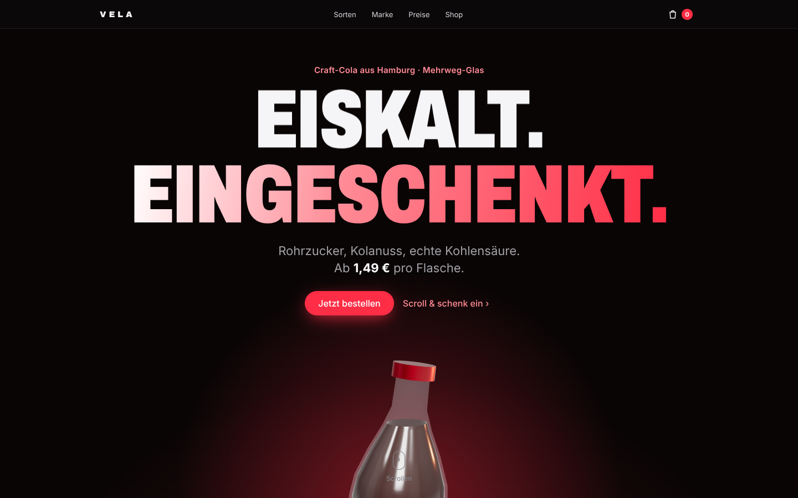
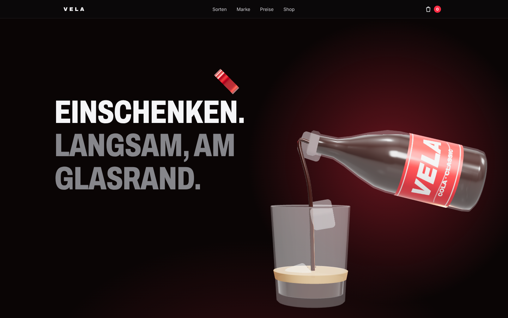
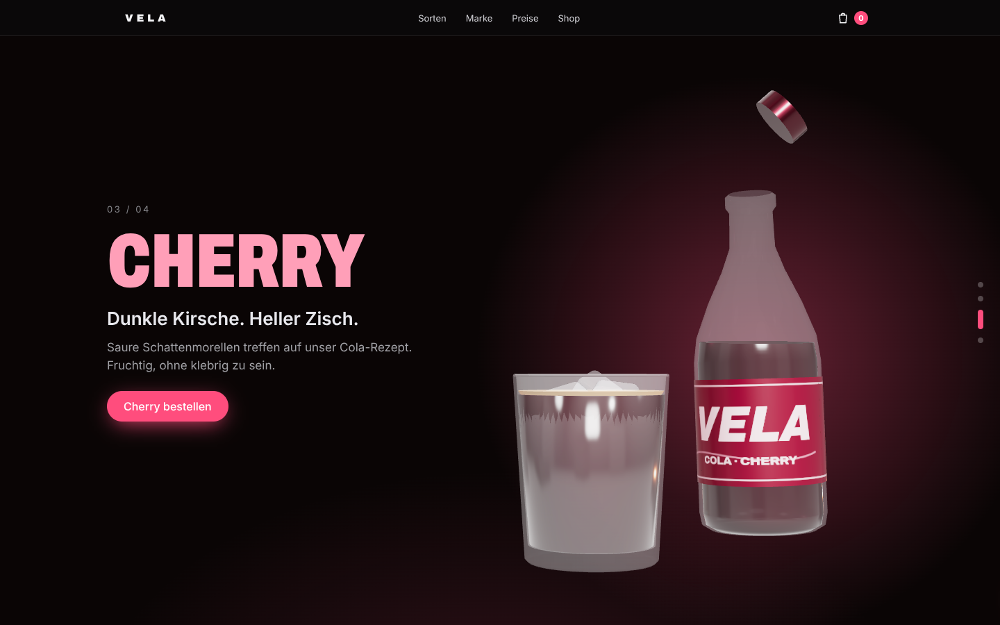

# VELA Cola – 3D Motion Website

Produktseite im Apple-Stil für eine (fiktive) Craft-Cola. Eine echte 3D-Szene (Three.js) erzählt beim Scrollen:
Deckel springt ab → Eiswürfel fallen ins Glas → die Flasche kippt und die Cola fließt ins Glas,
mit Schaum, Bläschen und Spritzern. Danach Sortenwechsel (Classic, Zero, Cherry, Vanilla),
Markengeschichte mit Zeitleiste, Werte, Zutaten und Nährwerte, Preis-Staffel und Shop mit Warenkorb inkl. Pfand.

## Starten

```bash
cd cola-site
python3 -m http.server 8000
```

Dann <http://localhost:8000> öffnen. Kein Build-Schritt; Three.js liegt in `vendor/`.

## Anpassen

- `products.js`: Markenname, Sorten (Etikett-, Deckel- und Flüssigkeitsfarbe), Preise, Packs, Pfand, Nährwerte
- `index.html`: Texte, Markengeschichte, Zeitleiste
- `main.js`: 3D-Szene und Scroll-Ablauf (`computeTargets`)

## Vorschau

| Hero | Einschenken | Sorten |
| --- | --- | --- |
|  |  |  |
