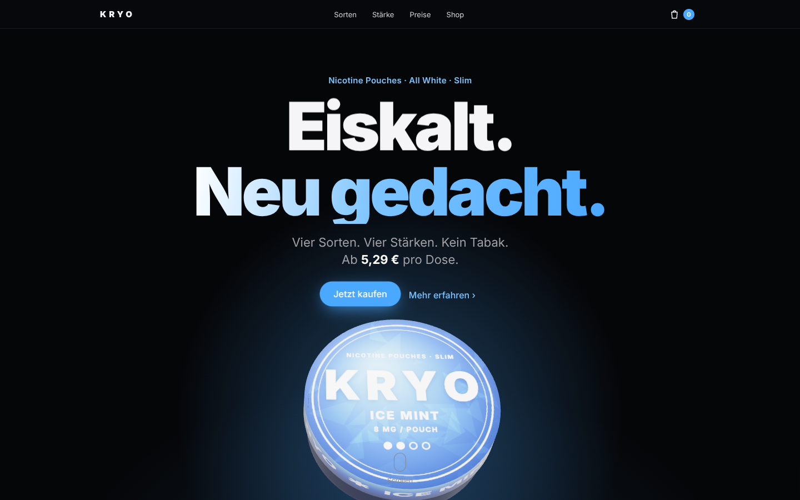
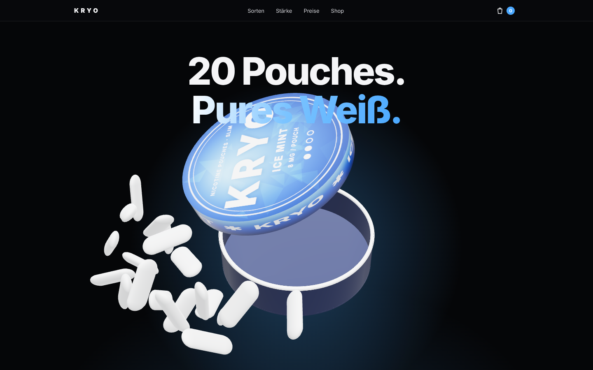
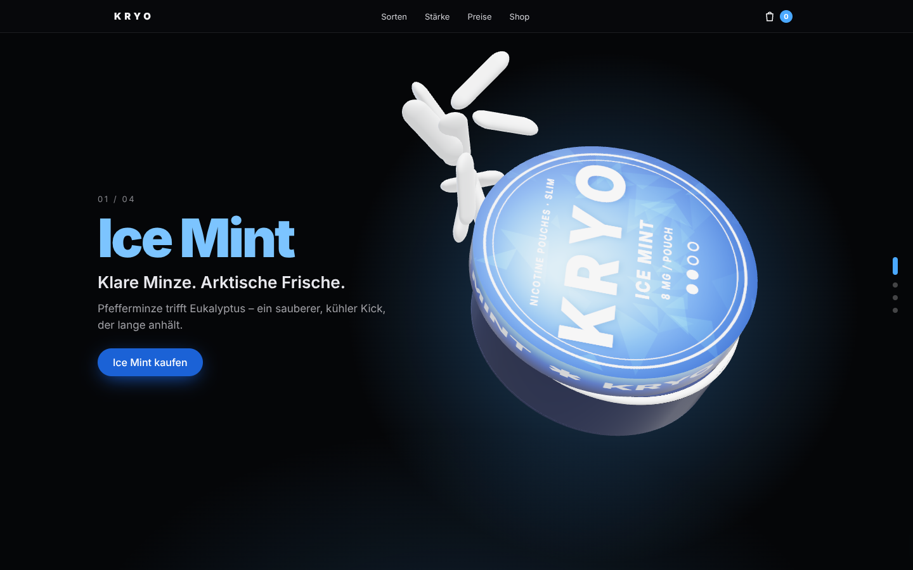

# KRYO – 3D Motion Website für Nicotine Pouches

Eine Produktseite im Stil der Apple-Produktseiten: eine echte 3D-Dose (Three.js) reagiert auf den
Scroll – sie dreht sich, der Deckel geht auf, die Pouches schweben heraus, die Sorte wechselt
Farbe und Label, danach folgen Stärke-Skala, Preis-Staffel, Shop mit Warenkorb und Pflicht-Warnhinweis.

KRYO ist eine **fiktive Demo-Marke**.

## Starten

Die Seite braucht nur einen statischen Webserver (wegen ES-Modulen, nicht per Doppelklick öffnen):

```bash
cd snus-site
python3 -m http.server 8000
```

Dann <http://localhost:8000> öffnen. Three.js liegt lokal in `vendor/`, kein Build-Schritt nötig.
Läuft auch direkt auf GitHub Pages, Netlify oder Vercel (Ordner `snus-site` als Root).

## Aufbau

| Sektion | Was passiert |
| --- | --- |
| Altersprüfung | 18+-Abfrage, wird im Browser gemerkt |
| Hero | Headline-Reveal, Dose schwebt, folgt der Maus |
| „Dreh auf.“ | Sticky-Scroll: Deckel hebt ab, 20 Pouches fliegen heraus, Zähler laufen hoch |
| Sorten | 4 Sorten – Dose dreht sich, Label/Farbe/Glow und Akzentfarbe der ganzen Seite wechseln |
| Stärke | Balken füllen sich beim Scrollen (4–16 mg) |
| Preise | 3 Bundles mit 3D-Tilt-Karten und automatisch berechneter Ersparnis |
| Shop | Filterbare Produktkarten, Warenkorb-Drawer mit Gratis-Versand-Balken |

## Anpassen

Alles Inhaltliche steht in **`products.js`**: Markenname, Sorten (Farben, Texte), Stärken, Preise,
Bundles und Versandgrenze. Die Dosen-Labels werden daraus automatisch gezeichnet.

**Eigene Produktfotos:** siehe [`assets/products/README.md`](assets/products/README.md).

## Dateien

- `index.html` – Struktur
- `styles.css` – Design (dunkles Apple-Look, responsive bis 360 px)
- `main.js` – 3D-Szene, Scroll-Choreografie, Shop & Warenkorb
- `products.js` – Daten
- `vendor/` – Three.js 0.160 + RoomEnvironment

## Vorschau

| Hero | Deckel öffnet | Sorten |
| --- | --- | --- |
|  |  |  |

## Pablo-Ice-Cold-Version

`pablo.html` ist dieselbe Seite mit Pablo Ice Cold & Mini Ice Cold: Sie lädt per Importmap
`products-pablo.js` statt `products.js`, die Dosenfotos liegen als Deckel-Textur auf der 3D-Dose
(`assets/products/pablo-*.webp`), dazu eine „So geht's“-Sektion mit dem Pouch-Foto.
Aufrufen über <http://localhost:8000/pablo.html>.

> Pablo-Logo, -Name und -Dosendesign gehören dem Hersteller. Öffentlich nur nutzen, wenn ihr
> autorisierter Händler seid bzw. die Rechte an den Bildern habt.
